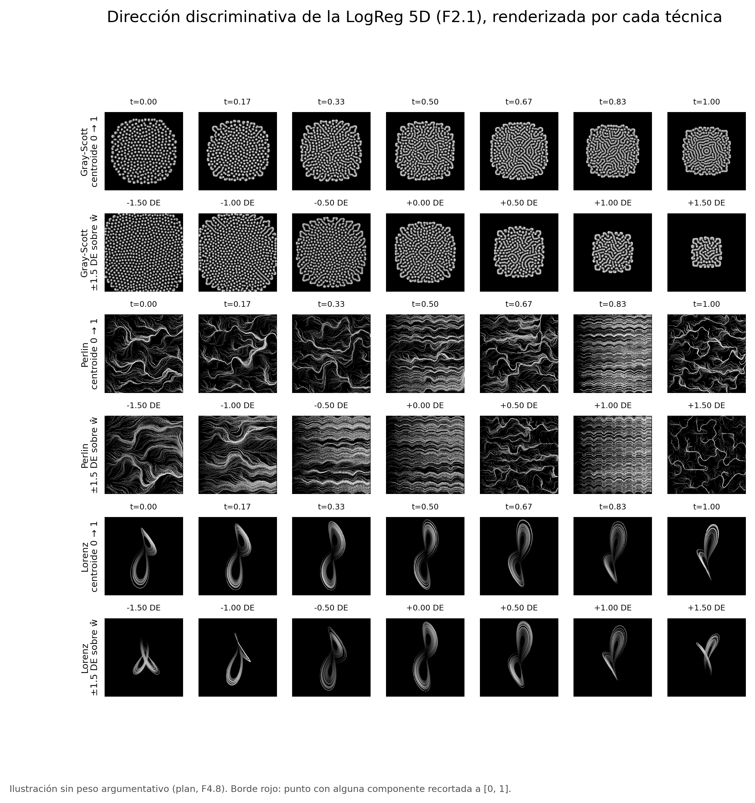

# F4.8 — Figura ilustrativa

> **Sin peso argumentativo** (`docs/plan_fase4.md`, F4.8): la figura solo ilustra cómo se ve la dirección discriminativa y no sustenta ninguna conclusión. No tiene métricas ni claves canónicas.
>
> **Nota.** Las imágenes de la figura se renderizan con la versión actual del generador, son ilustrativas y pueden no coincidir píxel a píxel con las del conjunto de entrenamiento.

## 1. Identificación

| Campo | Valor |
|---|---|
| Tarea | F4.8 del plan v2 (`plan/plan_tt2_v2.md`), Fase 4 — Análisis de preservación, «Figura ilustrativa» (A) |
| Responsable | SV — Santiago Elihu Soria Solís |
| Rama | `sv/f4-cierre` |
| Commit(s) | `4ff66d3` (código y pruebas sintéticas) · `ff1654c` (resoluciones) · `c578878` (corrección de `sys.path` antes de la corrida válida; HEAD al calcular) · `a27c440` (figura y recorridos) · `498dd03` (notebook) · commit de esta bitácora |
| Entregable | `results/f48_figura/f48_direccion_grises.png` y `f48_direccion_paleta_ilustrativa.png` |
| Evidencia | `results/f48_figura/` |
| Fechas de ejecución | `recorridos.json:meta.created_at` 2026-11-11T04:48:27+00:00 (2026-11-10, hora local) |
| Estado | **Cerrada** |

## 2. Propósito

La pregunta del plan es «¿Cómo se ve la dirección discriminativa?». Es una ilustración para el documento; no responde ninguna pregunta de la hipótesis.

## 3. Método

Método de `docs/plan_fase4.md` (F4.8-1…3), con las resoluciones de SV en `results/f48_figura/resoluciones.json` (commit `ff1654c`).

1. **Dirección.**
   - La LogReg `umap5d__logreg` de F2.1 (C = 0.1, `balanced`, StandardScaler en train), reproducida con el código de F2.1 sobre u de train.
   - Verificación: sus `p_dep` de val frente a `results/predictions/referencia/umap5d__logreg__none__seed42.csv`. Diferencia máxima 0.0, tolerancia 1e-9. Prueba no se usa.
2. **Recorridos en el espacio de u.**
   - Centroides de clase en train y 7 puntos lineales entre ellos.
   - ±1.5 DE en 7 puntos sobre ŵ = (w/σ)/‖w/σ‖, desde la media de train, con la DE de la proyección de u de train sobre ŵ (0.3779).
   - Ningún punto quedó fuera de [0, 1]: no hubo recorte.
3. **Renderizado.** Funciones de `src/generation`, en escala de grises:
   - Gray-Scott: ruta CPU con `run_gray_scott_safe`;
   - Perlin: `generate_perlin_image_classblind`;
   - Lorenz: `solve_attractor` y `render_attractor_enriched`.
   La versión con paleta (`viridis`) es solo ilustrativa.

| Parámetro | Valor |
|---|---|
| `direccion_espacio` / `de_recorrido` / `n_pasos_recorrido` | `u` / `proyeccion_train` / 7 |
| `tol_pdep` / `paleta` / `marca_recorte` | 1e-9 / `viridis` / `borde_y_lista` |

**Entorno.** Local, Windows 11 Pro, Python 3.13.2 (venv); árbol limpio en `c578878`. Duración: 164.3 s (Gray-Scott 82.2 s, Perlin 3.1 s, Lorenz 75.3 s).

## 4. Resultados

`results/f48_figura/recorridos.json`: puntos en u, máscara de recorte y `p_dep` de la LogReg en cada punto. Las 42 imágenes están en `imagenes/`.



## 5. Hallazgos

Ninguno con valor argumentativo.

**Desviaciones respecto del procedimiento previsto.**
1. **La primera corrida se detuvo al dibujar.** `ModuleNotFoundError: viz`: `src` no estaba en `sys.path` y ninguna prueba cubría `figura()`.
   - Ocurrió después de renderizar las 42 imágenes. Esa salida parcial se borró sin versionarla.
   - Se corrigió el código y se agregó la prueba de `figura()` (`c578878`). La segunda corrida, con el árbol limpio, es la versionada.
   - El renderizado es determinista (`test_render_determinista`), así que repetirlo no permite elegir entre imágenes.

## 6. Limitaciones

1. La figura no tiene peso argumentativo y no sustenta ninguna conclusión.
2. Ver la nota del encabezado sobre el renderizado.

## 7. Estado

**Cerrada.** La figura se generó según `docs/plan_fase4.md` y `resoluciones.json`.

| Pendiente | Responsable | Criterio de cierre |
|---|---|---|
| Incluir la figura en el documento con la nota sobre el renderizado | RP | Capítulo de análisis de preservación |

## 8. Artefactos

```
results/f48_figura/
├── resoluciones.json                       P7–P12 (SV, 2026-11-10)
├── recorridos.json                         dirección, recorridos, recorte, p_dep; meta con verificación de la LogReg
├── imagenes/                               42 PNG (3 técnicas × 2 recorridos × 7 puntos)
├── f48_direccion_grises.png
└── f48_direccion_paleta_ilustrativa.png    solo ilustrativa
src/fase4/figura_ilustrativa.py, tests/test_fase4_convergencia.py
notebooks/F4.8_figura.ipynb
```

## 9. Texto para el reporte técnico

**Qué muestra.** A modo de ilustración, sin valor argumentativo, se representó la dirección que separa las clases en el espacio UMAP de cinco dimensiones, la que aprende la regresión logística de referencia. Se recorrió el segmento entre los centroides de ambas clases y un trayecto de ±1.5 desviaciones estándar a lo largo de esa dirección desde la media. Cada punto se renderizó con los tres generadores.

**Advertencia.** Las imágenes se renderizan con la versión actual del generador, son ilustrativas y pueden no coincidir píxel a píxel con las del conjunto de entrenamiento.
