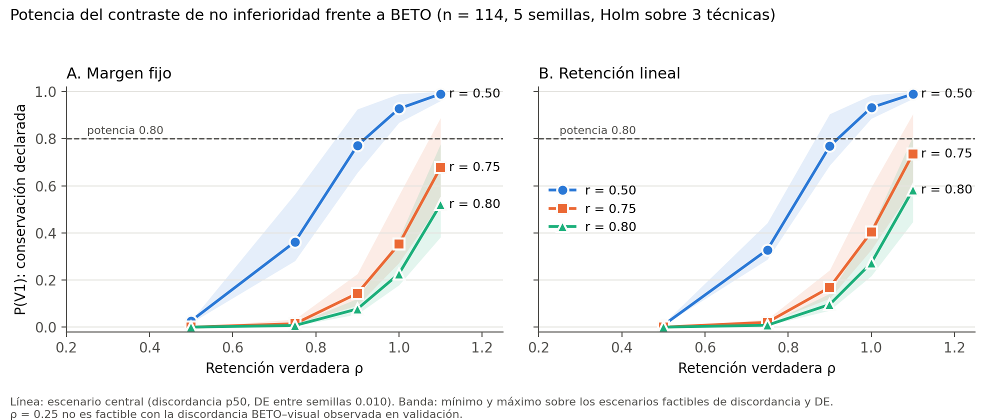

# Análisis de potencia del contraste de no inferioridad (F1.1)

> Tarea F1.1 del plan v2 · Rol: SV · Estado: **diseño fijado; resultados pendientes**
> Las secciones 1 a 6 se versionan con commit propio antes de ejecutar. Las secciones 7 y 8 se completan después.
> Insumos: `docs/datos.md`, `docs/especificacion_predicciones.md`, `results/canonical_numbers.json`.

## 1. Propósito

Estimar, antes de cualquier resultado confirmatorio, la capacidad del protocolo para decidir el Objetivo V con n = 114 y cinco semillas por finalista: el ancho esperado del intervalo del estadístico principal, la menor retención verdadera que el protocolo puede declarar con potencia de 0.80 y la probabilidad de cada veredicto (V1–V4) en escenarios plausibles. Sus resultados informan la elección de la retención exigida *r* en F1.2; no constituyen un contraste.

## 2. Estadístico y margen por retención del efecto

El margen se define por retención de la capacidad discriminativa por encima del azar, con $F1_{azar} = 0.5$, el F1-Macro esperado de un clasificador aleatorio estratificado, valor teórico independiente de los datos del proyecto.

Se evalúan dos formulaciones equivalentes en su punto, distintas en su tratamiento de la incertidumbre de BETO:

| Formulación | Estadístico | Hipótesis alternativa | Tratamiento de BETO |
|---|---|---|---|
| **A. Margen fijo** | $\Delta_t = F1_{BETO} - \overline{F1}_{img,t}$, con $\delta = (1-r)(F1^{obs}_{BETO} - 0.5)$ | $\Delta_t < \delta$ | $F1_{BETO}$ fijo en su valor observado al calcular δ |
| **B. Retención lineal** | $\theta_t = (\overline{F1}_{img,t} - 0.5) - r\,(F1_{BETO} - 0.5)$ | $\theta_t > 0$ | $F1_{BETO}$ se remuestrea junto con el visual |

En ambas, $\overline{F1}_{img,t}$ es la media del F1-Macro de prueba de las cinco semillas del finalista, cada uno calculado sobre las mismas muestras remuestreadas.

**Valores de r evaluados:** 0.50, 0.75 y 0.80. Con $F1^{obs}_{BETO} = 0.7039$ (`ref.beto_exp41.f1_macro`), δ = 0.1019, 0.0510 y 0.0408.

## 3. Regla de decisión simulada

- *Bootstrap* pareado: B réplicas de índices de prueba con reemplazo, comunes a BETO y a las cinco semillas.
- Valor *p* unilateral por *bootstrap*: proporción de réplicas con $\Delta^* \ge \delta$ (A) o con $\theta^* \le 0$ (B).
- Corrección de Holm sobre las tres técnicas, α = 0.05.
- Superioridad sobre el piso: prueba de permutación con 10,000 permutaciones frente a un piso de 0.529 (brillo promedio de WITCOM, el mayor de los pisos conocidos), con Holm.
- Veredictos (con el nivel de confianza ajustado por Holm para cada técnica): V3 si no supera el piso; V1 si supera el piso y se rechaza H₀; V2 si supera el piso y el intervalo indica pérdida mayor al margen (A: límite inferior de Δ > δ; B: límite superior de θ < 0); V4 en otro caso.

## 4. Insumos y su papel

| Insumo | Fuente | Papel |
|---|---|---|
| `y_test` y `y_val` (70/44) | `meta/sample_index.csv` | Estructura de clases |
| Predicciones de BETO, val y test | `results/predictions/referencia/text__beto__finetune__seed42.csv` | Término de BETO; patrón de aciertos |
| Predicciones de la primera pasada (F3.2, versión sustituida), solo validación | `results/f32_primera_pasada/predictions.csv` | Calibración empírica del acuerdo BETO–visual y de la variabilidad entre semillas |
| Predicciones del clasificador sobre 768D, val | `results/predictions/referencia/emb768__logreg__none__seed42.csv` | Calibración del acuerdo entre BETO y un clasificador que no ve el texto |

Las predicciones de F3.2 son de validación, usan un preprocesamiento sustituido en Perlin y Lorenz (F1.4) y tienen `p_dep` redondeado a seis decimales. Se usan **solo para planificar**: no seleccionan modelos ni intervienen en ninguna decisión confirmatoria. No se dispone de predicciones por muestra de la CNN de WITCOM.

No se calcula ninguna métrica de prueba de modelos visuales. Las métricas de prueba de BETO ya son conocidas (F2.2).

## 5. Bloques de análisis

| Bloque | Contenido |
|---|---|
| **E. Empírico** | Para cada configuración de F3.2 (18) y para el clasificador sobre 768D, sobre validación: ancho del IC bilateral de Δ y de θ al nivel de Holm, con BETO-val como referencia. Distribución de la tasa de discordancia BETO–visual y de la DE entre semillas |
| **S. Simulación** | Generador de predicciones visuales para cinco semillas con: retención verdadera $\rho \in \{0.25, 0.50, 0.75, 0.90, 1.00, 1.10\}$, acuerdo con BETO calibrado con E (percentiles 10, 50 y 90 de la discordancia) y DE entre semillas ∈ {0.005, 0.010, 0.015}. Para cada escenario y cada r: P(V1), P(V2), P(V3), P(V4), con 1,000 simulaciones |
| **D. Retención mínima detectable** | Para cada r y formulación, la menor $\rho$ con P(V1) ≥ 0.80, por interpolación sobre la malla de S |
| **P. Piso** | Potencia de la superioridad sobre el piso en los mismos escenarios |

El generador de S se documenta en el script: para cada muestra, el acierto visual se obtiene como el acierto de BETO con probabilidad *a* (acuerdo) o como un acierto independiente con probabilidad por clase ajustada para alcanzar la retención objetivo; las semillas comparten el componente de acuerdo y difieren en el independiente, calibrado para la DE objetivo. La calibración se verifica reportando la retención y la DE realizadas en cada escenario.

## 6. Parámetros de ejecución

| Parámetro | Valor |
|---|---|
| B (en E y en cada simulación de S) | 2,000 en S; 10,000 en E |
| Simulaciones por escenario | 1,000 |
| Semilla maestra | 2026; semillas derivadas con `numpy.random.SeedSequence` |
| Cálculo del F1-Macro | Vectorizado a partir de conteos de la matriz de confusión (no `sklearn` dentro del bucle), verificado contra `f1_score(..., average='macro')` en 100 réplicas |
| Ejecución | Local si la estimación es ≤ 20 min; en otro caso, Kaggle (`docs/ejecucion_kaggle.md`) |

B = 2,000 en S introduce un error de Monte Carlo en los límites del intervalo que se reporta junto con las potencias.

## 7. Resultados

> Corrida local del 2 de noviembre de 2026 (Windows, CPU, 6 procesos, 6.6 min) con el código del commit `cb5f567`. Las salidas están en `results/f11_potencia/` (ver su `README.md`). Las cifras se toman de esos archivos, sin redondear más allá de lo indicado.

### 7.0 Aclaraciones de implementación (fijadas antes de ejecutar)

Se documentan en el docstring de `potencia.py` (commit `af6abc9`, anterior a la ejecución):

1. **Holm en S.** Cada réplica simula tres técnicas independientes bajo el mismo escenario, con el mismo BETO y los mismos índices de *bootstrap*. Se aplica Holm completo y P(V) se promedia sobre las tres técnicas.
2. **Nivel de los intervalos.** Para la técnica en el rango *k* de Holm, α_h = α/(3−k+1), y el intervalo es bilateral al 1−2α_h, de modo que cada límite es una cota unilateral a α_h. V1 equivale al rechazo de Holm (p ≤ α_h en el procedimiento escalonado).
3. **Piso.** Se permutan las etiquetas de prueba (10,000 permutaciones) y se calcula el F1 medio de las cinco semillas. El nulo se desplaza para que su media sea 0.529 (modelo de corrimiento), y p = (1 + #{nulo ≥ observado})/(N + 1). Holm se aplica aparte sobre las tres técnicas.
4. **Verificaciones previas.**
   - El F1 vectorizado coincide con `sklearn` en 100 réplicas (diferencia máxima 0).
   - El F1-val recalculado de las 54 corridas de F3.2 coincide con `canonical_numbers.json` (diferencia máxima 0).
   - El F1 recalculado de BETO (val 0.7199, test 0.7039) coincide con `ref.beto_exp41.f1_macro`.

### 7.1 Bloque E: empírico en validación (`empirico.csv`, `empirico_corridas.csv`)

**Ancho del IC de Δ y de θ** frente a BETO-val. Cada fila resume las 18 configuraciones de F3.2, con la media de 3 semillas cada una; se da la mediana y, entre corchetes, el mínimo y el máximo.

| Estadístico | α_h = α/3 (IC 96.7 %) | α_h = α/2 (IC 95 %) | α_h = α (IC 90 %) |
|---|---|---|---|
| Δ | 0.129 [0.111, 0.146] | 0.119 [0.103, 0.134] | 0.100 [0.087, 0.112] |
| θ, r = 0.50 | 0.123 [0.106, 0.138] | 0.114 [0.097, 0.126] | 0.096 [0.082, 0.105] |
| θ, r = 0.75 | 0.118 [0.098, 0.133] | 0.108 [0.091, 0.123] | 0.090 [0.075, 0.104] |
| θ, r = 0.80 | 0.119 [0.099, 0.134] | 0.110 [0.091, 0.124] | 0.091 [0.076, 0.104] |
| Δ, LogReg-768D (1 semilla) | 0.037 | 0.034 | 0.031 |

- **Discordancia BETO–visual** por corrida (54 corridas): p10 = 0.0877, p50 = 0.1140, p90 = 0.1404. La de LogReg-768D es 0.0088.
- **DE entre semillas** (18 configuraciones, ddof = 1): mínimo 0.0021, mediana 0.0136, máximo 0.0254.

Con α_h = α/3, el IC de Δ mide entre 0.11 y 0.15 de ancho. Eso es mayor que los tres márgenes δ (0.1019, 0.0510 y 0.0408). En cambio, el clasificador sobre 768D, que casi siempre coincide con BETO, produce intervalos tres o cuatro veces más estrechos: el ancho depende sobre todo de la discordancia.

### 7.2 Bloque S: malla de escenarios (`malla_escenarios.csv`)

**Factibilidad.** Con la discordancia observada, el generador no alcanza ρ = 0.25 en ningún escenario, ni ρ = 0.50 con la discordancia p10. Esas 12 de las 54 celdas se marcan `factible = False` y no se simulan. La razón es que una discordancia de 9–14 % no deja margen para perder tanta capacidad discriminativa respecto de BETO.

Hay una sola celda con `de_factible = False`: ρ = 0.50, p50, DE 0.015, cuya DE realizada fue 0.0123. En las celdas factibles, la retención, la DE y la discordancia realizadas difieren de las objetivo en menos de 0.01, 0.0005 y 0.003, respectivamente (detalle en `potencia.log`).

**P(V1) en el escenario central** (discordancia p50, DE 0.010). Error de Monte Carlo: SE ≤ 0.011 en toda la malla.

| ρ | A, r=0.50 | A, r=0.75 | A, r=0.80 | B, r=0.50 | B, r=0.75 | B, r=0.80 |
|---|---|---|---|---|---|---|
| 0.50 | 0.026 | 0.000 | 0.000 | 0.008 | 0.000 | 0.000 |
| 0.75 | 0.362 | 0.014 | 0.007 | 0.328 | 0.020 | 0.008 |
| 0.90 | 0.771 | 0.143 | 0.077 | 0.768 | 0.169 | 0.096 |
| 1.00 | 0.927 | 0.352 | 0.226 | 0.932 | 0.404 | 0.272 |
| 1.10 | 0.990 | 0.677 | 0.521 | 0.990 | 0.735 | 0.583 |

**Rango de P(V1) sobre los escenarios factibles** de discordancia y DE, como [mínimo, máximo]:

| ρ | A, r=0.50 | B, r=0.50 | A, r=0.75 | B, r=0.75 | A, r=0.80 | B, r=0.80 |
|---|---|---|---|---|---|---|
| 0.90 | [0.66, 0.92] | [0.69, 0.90] | [0.09, 0.23] | [0.12, 0.24] | [0.05, 0.12] | [0.07, 0.14] |
| 1.00 | [0.87, 0.99] | [0.89, 0.98] | [0.27, 0.56] | [0.33, 0.59] | [0.18, 0.38] | [0.22, 0.42] |
| 1.10 | [0.96, 1.00] | [0.97, 1.00] | [0.53, 0.89] | [0.59, 0.90] | [0.38, 0.78] | [0.45, 0.81] |

**Resto de veredictos.**
- Cuando no se declara V1, el veredicto dominante es V4 (no concluyente) si ρ ≥ 0.75, y V3 si ρ = 0.50, por no superar el piso.
- P(V2) nunca supera 0.077; el máximo se da en ρ = 0.75, p10, DE 0.015, B, r = 0.80.
- El SE de Monte Carlo del límite del IC usado por V1, debido a B = 2,000, es ≤ 0.0047.

### 7.3 Bloque D: retención mínima detectable (`retencion_minima.csv`)

Es la menor ρ con P(V1) ≥ 0.80, obtenida por interpolación lineal sobre la malla.

| Formulación, r | Central (p50, DE 0.010) | Rango sobre escenarios |
|---|---|---|
| A, 0.50 | ρ_min = 0.919 (F1 = 0.6873) | 0.848–0.968 |
| B, 0.50 | ρ_min = 0.920 (F1 = 0.6875) | 0.866–0.957 |
| A, 0.75 | no se alcanza en la malla (ρ ≤ 1.10) | solo p10 con DE ≥ 0.010: 1.073–1.096 |
| B, 0.75 | no se alcanza | solo p10 con DE ≥ 0.010: 1.066–1.089 |
| A, 0.80 | no se alcanza | no se alcanza en ningún escenario |
| B, 0.80 | no se alcanza | solo p10, DE 0.015: 1.098 |

### 7.4 Bloque P: superioridad sobre el piso (`potencia_piso.csv`)

P(superar el piso de 0.529 con Holm), con SE ≤ 0.010:

| ρ | Rango |
|---|---|
| 0.50 | 0.197–0.282 |
| 0.75 | 0.884–0.981 |
| ≥ 0.90 | ≥ 0.989 |

### 7.5 Cifras canónicas

`results/f11_potencia/canonical_fragment.json`, con `status = extraido` y marcadas como cifras de diseño:
- `f11.delta_margen.r0_50/r0_75/r0_80`;
- `f11.f1_min_detectable.{a,b}.r0_50/r0_75/r0_80`, que son nulas cuando no se alcanzan.

Estas cifras están en escala de F1 pero no provienen de una matriz de confusión. Por eso `tests/test_canonical_numbers.py` las exime de la prueba de alcanzabilidad (commit `5369d9b`).

### 7.6 Limitaciones

1. La discordancia y la DE se calibran con predicciones de validación de la primera pasada v0. Esas predicciones tienen 3 semillas (no 5), un preprocesamiento sustituido en Perlin y Lorenz y `p_dep` redondeado. Se suponen trasladables a prueba y a los finalistas.
2. El generador supone que los errores visuales no compartidos con BETO son independientes entre muestras dentro de cada clase y que las tres técnicas son independientes entre sí condicionadas a BETO. Las técnicas reales comparten los mismos 5 valores UMAP, por lo que probablemente estén correlacionadas. Esto afecta la **estimación de la potencia**, pero no la **validez** del contraste: Holm controla la tasa de error por familia ante cualquier dependencia entre técnicas.
3. El F1 objetivo se fija sobre el valor esperado de una semilla. La retención realizada (media de 5 semillas) coincide con la objetivo con un error menor a 0.01 (`potencia.log`).
4. El nulo desplazado del piso es una aproximación de corrimiento, porque el piso de 0.529 es una cifra exploratoria de WITCOM sin predicciones por muestra.

## 8. Recomendación para F1.2

> **Propuesta de Claude Code, pendiente de revisión por SV.** No es una decisión hasta que SV la apruebe y se congele en `docs/protocolo_preregistrado.md`.

**Formulación: B (retención lineal).**
- Su potencia es igual o ligeramente mayor que la de A en toda la malla. En el escenario central con ρ = 1.00, P(V1) es 0.404 frente a 0.352 con r = 0.75, y 0.272 frente a 0.226 con r = 0.80.
- Remuestrea F1_BETO junto con el modelo visual, en lugar de fijar δ en un valor observado que también tiene error de muestreo.
- Su hipótesis se lee directamente como «el modelo visual conserva al menos una fracción *r* de la capacidad de BETO por encima del azar».
- Su retención mínima detectable con r = 0.50 es prácticamente la misma que la de A (0.920 frente a 0.919).

**Retención exigida: la elección es un compromiso que debe resolver SV.**
- Con **r = 0.75 u r = 0.80**, el protocolo no alcanza potencia de 0.80 ni siquiera si la imagen conserva toda la capacidad de BETO (ρ = 1.00): P(V1) = 0.40 y 0.27 en el escenario central. Con n = 114, el veredicto más probable para un modelo que conserva todo sería V4 (no concluyente). Esos valores de *r* solo son defendibles si se acepta de antemano que V4 es el desenlace esperado y se interpreta como tal.
- Con **r = 0.50** (δ equivalente = 0.1019), la potencia es 0.93 con ρ = 1.00 y la retención mínima detectable es ρ ≈ 0.92 (F1 ≈ 0.688). El costo es que el criterio de conservación es laxo: basta con retener la mitad de la ventaja de BETO sobre el azar.
- **Propuesta:** r = 0.50 como contraste principal y r = 0.75 como análisis de sensibilidad preregistrado, que se reporta sin cambiar el veredicto principal. En el documento se diría explícitamente que, con n = 114, el protocolo solo tiene potencia para detectar conservación «de al menos la mitad».

**Declaración.** Al fijar la formulación y *r*, ya se conocían:
- el Δ exploratorio de WITCOM (Gray-Scott + ResNet-18, test consultado antes del protocolo) = −0.0103 (`witcom.delta_beto_gs_resnet18.f1_macro`);
- las métricas de prueba de BETO (F2.2).

Ningún resultado de prueba de los modelos visuales de TT-II intervino en este análisis.
